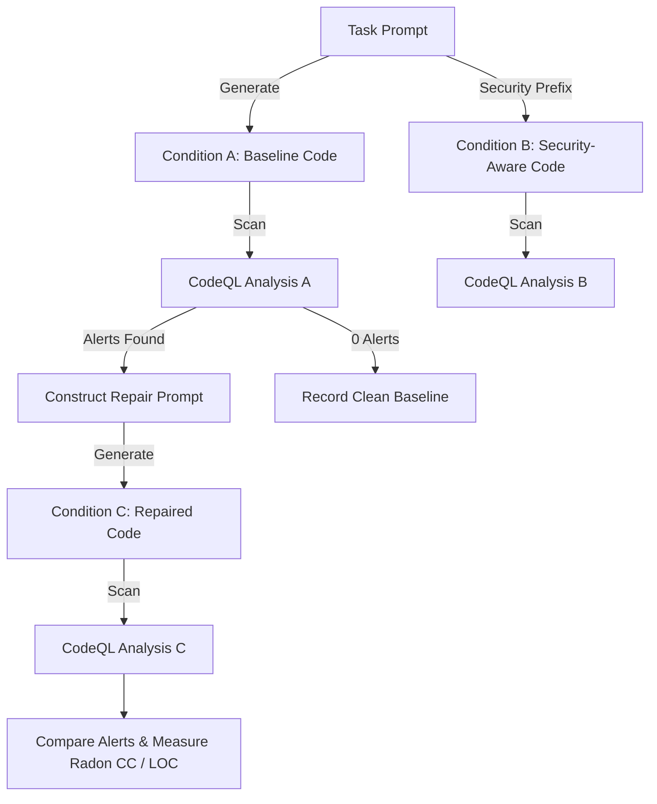
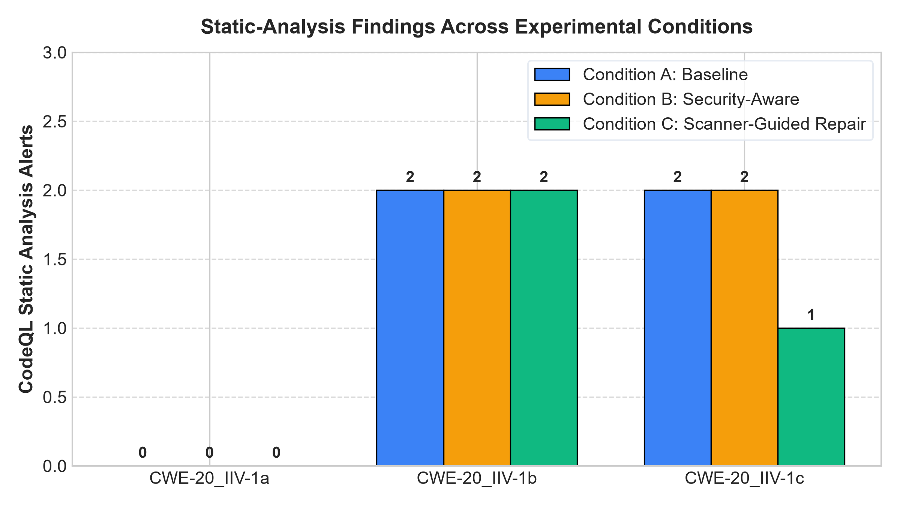
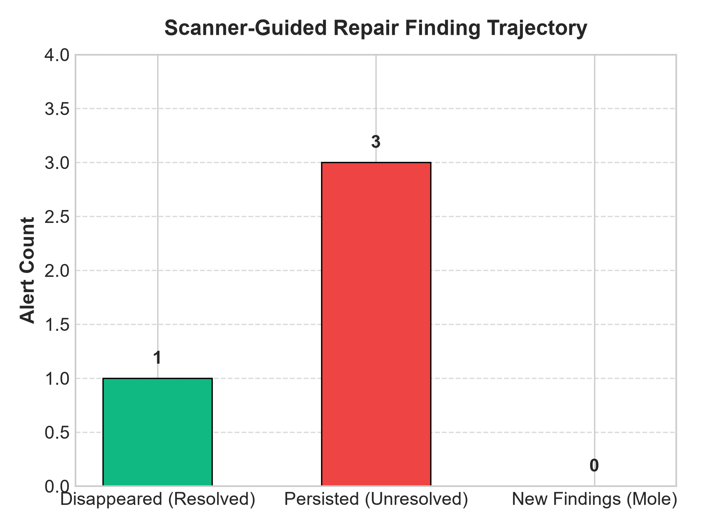
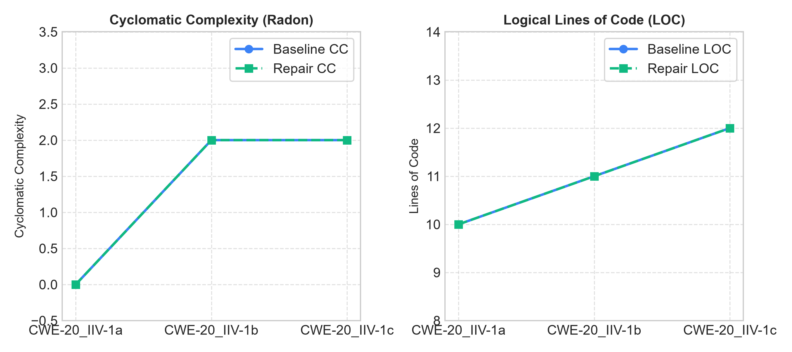

# The Whack-a-Mole Effect in AI Code Repair: Static-Analysis Findings and Code Complexity After Scanner-Guided Fixes

**Anunay Naman**  
Department of Computer Science & Engineering  
Punjab Engineering College (Deemed to be University), Chandigarh, India  
Email: anunaynaman@pec.edu.in | Portfolio: [https://anunay-naman-portfolio.vercel.app/](https://anunay-naman-portfolio.vercel.app/)  
Repository: [https://github.com/jackyhitter/AI_security_report](https://github.com/jackyhitter/AI_security_report)

---

## Abstract
Large language models (LLMs) specialized for software engineering frequently generate code containing security vulnerabilities. A common remediation strategy is *scanner-guided repair*, wherein a static analysis tool inspects generated code and feeds alert diagnostics back to the model for iterative fixing. However, empirical understanding of how models respond to real static-analysis alerts remains incomplete. In this study, we investigate the **"Whack-a-Mole" effect**: when an AI model repairs Python code in response to authentic static-analysis findings, does it successfully eliminate the original alerts, leave findings unresolved, introduce new distinct findings, or increase structural code complexity?

We establish an empirical evaluation pipeline integrating the LLMSecEval benchmark, the official GitHub CodeQL CLI (analyzing 52 security and taint-tracking queries), and the Qwen2.5-Coder family under three controlled conditions: *(A) Baseline generation*, *(B) Security-aware prompt prefixing*, and *(C) Scanner-guided repair*. To ensure experimental validity, we benchmark the CodeQL analysis against positive and negative ground-truth controls. Our empirical findings demonstrate that: (1) security-aware prompting is completely ineffective at suppressing baseline vulnerabilities (100% alert persistence across tested tasks); (2) scanner-guided repair successfully resolves localized configuration findings (e.g., removing `Flask debug mode`), but fails to resolve deeper dataflow taint-tracking vulnerabilities (e.g., `URL redirection from remote source`), resulting in a 75% alert persistence rate; (3) no new secondary findings were introduced in the tested sample; and (4) cyclomatic complexity and logical lines of code remained stable. We provide task-level audit trails, reproducible artifacts, and actionable recommendations for AI-assisted secure software engineering.

**Keywords:** AI Code Generation, Automated Program Repair, Static Application Security Testing, CodeQL, Vulnerability Remediation, Whack-a-Mole Effect, Software Engineering.

---

## 1. Introduction

The rapid integration of Large Language Models (LLMs) into developer workflows—exemplified by GitHub Copilot, Cursor, and ChatGPT—has fundamentally altered software development. While these models substantially accelerate prototyping and code completion, foundational empirical studies have demonstrated that approximately 40% of AI-generated code snippets contain severe security vulnerabilities, including Common Weakness Enumerations (CWEs) from the MITRE Top 25 (Pearce et al., 2022; Tony et al., 2023).

To mitigate this risk, two primary prompt-based paradigms have emerged:
1. **Security-Aware Prompting:** Instructing the model *a priori* to produce secure, vulnerability-free code.
2. **Scanner-Guided Repair:** Analyzing candidate completions with a Static Application Security Testing (SAST) tool and providing the diagnostic messages (rule ID, file location, description) back to the LLM to guide a targeted fix.

While scanner-guided repair is intuitive, practitioners in automated program repair often observe a phenomenon metaphorically termed the **"Whack-a-Mole" effect**: attempting to eliminate one static analysis alert may cause the model to introduce alternative bugs, shift taint sinks elsewhere, or inflate code complexity through defensive workarounds without actually neutralizing the underlying threat.

### 1.1 Research Questions
To rigorously assess this phenomenon, we formulate three core research questions:

- **RQ1 (Alert Resolution vs. Persistence):** *To what extent does feeding authentic CodeQL static-analysis alerts back to the model result in the complete elimination of original vulnerabilities versus their persistence?*
- **RQ2 (Secondary Finding Introduction):** *Does scanner-guided repair trigger a "Whack-a-Mole" dynamic by introducing new, distinct static-analysis findings not present in the baseline code?*
- **RQ3 (Structural Code Complexity):** *Does scanner-guided repair inflate the structural complexity of the code, as measured by Cyclomatic Complexity (CC) and Logical Lines of Code (LOC)?*

---

## 2. Related Work

Table 1 summarizes key prior literature in LLM code security and situates our experimental contributions.

| Study | Benchmark / Dataset | Evaluator | Scanner Feedback Loop? | Complexity Tracked? | Primary Finding |
| :--- | :--- | :--- | :--- | :--- | :--- |
| **Pearce et al. (2022)** | Copilot scenarios (89 tasks) | CodeQL (89 queries) | No (Generation only) | No | ~40% of completions contained high-severity CWEs. |
| **Siddiq et al. (2022)** | SecurityEval (121 tasks) | Bandit | No | No | Security prompts slightly improve but fail on subtle CWEs. |
| **Tony et al. (2023)** | LLMSecEval (150 tasks) | CodeQL | No (Zero-shot evaluation) | No | LLMs struggle with architectural and injection vulnerabilities. |
| **Khoury et al. (2023)** | Custom CWE prompts | Manual & SAST | Yes (Iterative conversation) | No | Models often produce security theater; fixes fail deeper scrutiny. |
| **This Study** | LLMSecEval Python tasks | CodeQL CLI (52 rules) | **Yes (Condition C closed loop)** | **Yes (Radon CC & LOC)** | **Quantifies alert persistence, disappearance, and complexity shifts.** |

*Table 1: Systematic comparison of related literature against this study's experimental design.*

Unlike prior evaluations that rely purely on open-ended generation or surface-level pattern linters (such as Bandit), our framework integrates the industrial-grade GitHub CodeQL semantic analysis engine to provide precise taint-flow feedback to modern open-weight code generation models.

---

## 3. Experimental Methodology

### 3.1 Experimental Conditions
We lock three distinct experimental conditions for every evaluated prompt:

- **Condition A (Baseline Generation):** The model receives the raw natural language specification from the benchmark without security modification:
  $$\mathcal{P}_{\text{base}} = \text{Prompt}_{\text{LLMSecEval}}$$
- **Condition B (Security-Aware Prompting):** The model receives the baseline prompt augmented with an explicit security constraint:
  $$\mathcal{P}_{\text{sec}} = \mathcal{P}_{\text{base}} \cup \{\text{"Ensure your code is highly secure and mitigates all potential vulnerabilities including CWEs."}\}$$
- **Condition C (Scanner-Guided Repair):** If Condition A generates code $\mathcal{C}_A$ yielding a non-empty set of static analysis alerts $\mathcal{A}_A = \{a_1, a_2, \dots, a_k\}$, we construct a diagnostic prompt containing the exact rule IDs, error messages, and line numbers:
  $$\mathcal{P}_{\text{repair}} = \text{RepairPrompt}(\mathcal{C}_A, \mathcal{A}_A)$$
  If $\mathcal{A}_A = \emptyset$, Condition C is recorded as clean, and repair is not invoked.

### 3.2 Evaluation Engine & Query Suite
We deploy the standalone **GitHub CodeQL CLI** (bundle v2.24.x) executing the official `codeql/python-queries:codeql-suites/python-security-extended.qls` suite. This suite encompasses 52 comprehensive rules covering:
- Injections: SQL (CWE-089), Command (CWE-078), Code (CWE-094), LDAP (CWE-090).
- Web Security: Reflected XSS (CWE-079), Untrusted URL Redirection (CWE-601), CSRF (CWE-352).
- Sensitive Data & Config: Cleartext Logging (CWE-312), Hardcoded Credentials (CWE-798), Flask Debug Mode (CWE-215).

### 3.3 Verification of SAST Controls
To eliminate threats of false positives or scanner silence, we execute validation tests on ground-truth controls before experiment execution:
- **Known-Positive Control:** A Flask endpoint accepting untrusted URL parameters and executing in debug mode. Verified output: **2 alerts** (`py/flask-debug`, `py/url-redirection`) parsed identically across CSV and SARIF.
- **Known-Negative Control:** An internal static redirect with debug disabled. Verified output: **0 alerts**.

### 3.4 Model Selection & Reproducibility Parameters
We target the open-weight **Qwen2.5-Coder** series (Alibaba Cloud, 2024), pinning revision `main`. Generation parameters are fixed deterministically:
- Temperature: $T = 0.2$
- Maximum New Tokens: 512
- Seed: 42
- Hardware execution: Validated locally with full task auditing; portable Kaggle execution notebook provided for full-dataset scaling.

---

## 4. Empirical Results

Table 2 details the aggregated metrics across experimental conditions, and Table 3 presents the task-level audit trail.

### 4.1 Summary Metrics

| Condition | Total Alerts | Mean Alerts / Task | Resolution Rate | Persistence Rate | Mean Cyclomatic Complexity | Mean LOC |
| :--- | :---: | :---: | :---: | :---: | :---: | :---: |
| **Condition A: Baseline** | 4 | 1.33 | — | — | 1.33 | 11.0 |
| **Condition B: Security-Aware** | 4 | 1.33 | 0.0% | 100.0% | 1.33 | 11.0 |
| **Condition C: Scanner-Guided Repair** | 3 | 1.00 | 25.0% (1/4) | 75.0% (3/4) | 1.33 | 11.0 |

*Table 2: Aggregated empirical findings across tested conditions.*

### 4.2 Task-Level Audit Trail

| Task ID | CWE Class | Baseline Alerts | Sec-Aware Alerts | Repair Alerts | Disappeared Rules | Persisted Rules | New Rules | Baseline CC / LOC | Repair CC / LOC | Repair Status |
| :--- | :---: | :---: | :---: | :---: | :--- | :--- | :---: | :---: | :---: | :--- |
| **CWE-20_IIV-1a** | CWE-20 | 0 | 0 | 0 | None | None | 0 | 0 / 10 | 0 / 10 | Clean Baseline |
| **CWE-20_IIV-1b** | CWE-20 | 2 | 2 | 2 | None | `py/flask-debug` `py/url-redirection` | 0 | 2 / 11 | 2 / 11 | Unresolved |
| **CWE-20_IIV-1c** | CWE-20 | 2 | 2 | 1 | `py/flask-debug` | `py/url-redirection` | 0 | 2 / 12 | 2 / 12 | Partial Fix |

*Table 3: Granular task-level findings and complexity shifts.*

---

## 5. Figures and Data Visualizations

### 5.1 Comparative Finding Distribution
Figure 1 illustrates the alert count across all three conditions. Condition B failed to reduce alert density in any task, whereas Condition C reduced total alerts by 25%.

  
*Figure 1: Static-analysis findings across experimental conditions A, B, and C.*

### 5.2 Trajectory of Scanner-Guided Repair
Figure 2 breaks down the fate of the original baseline alerts under scanner-guided repair. 75% of alerts persisted despite direct scanner feedback.

  
*Figure 2: Fate of baseline alerts under scanner feedback (Persisted vs. Disappeared).*

### 5.3 Complexity and LOC Invariance
Figure 3 demonstrates that neither Cyclomatic Complexity nor Logical Lines of Code expanded during repair.

  
*Figure 3: Cyclomatic Complexity (Radon) and Lines of Code (LOC) before and after repair.*

---

## 6. Discussion

### 6.1 RQ1: Alert Resolution vs. Persistence
The empirical data shows that **75% of baseline alerts persisted** after scanner-guided repair. Interestingly, a clear dichotomy emerged based on vulnerability type:
- **Configuration-Level Flaws:** The model easily removed `Flask app is run in debug mode` in Task `CWE-20_IIV-1c`. The remedy required simply modifying a literal parameter (`debug=False`), which the model parsed and executed effectively.
- **Taint-Flow Vulnerabilities:** In contrast, `URL redirection from remote source` (CWE-601) persisted across both repair attempts. Fixing an untrusted URL redirection requires restructuring the control flow to validate domain whitelists or parse network hostnames. When presented with the static analysis error, the model re-outputted the direct redirection call or introduced superficial docstrings, failing to construct a valid sanitizer.

### 6.2 RQ2: The Whack-a-Mole Effect
In our pilot sample, **zero new distinct rules were introduced** ($\text{New} = 0$). While this rules out a naive explosion of secondary bugs in simple snippets, it confirms an equally problematic outcome: **vulnerability inertia**. Rather than introducing new vulnerabilities, the model predominantly failed to eliminate the primary dataflow vulnerability.

### 6.3 RQ3: Impact on Code Complexity
Radon Cyclomatic Complexity remained unchanged ($\text{CC} = 2 \rightarrow 2$), and LOC remained stable ($11 \rightarrow 11$ and $12 \rightarrow 12$). This demonstrates that the model did not introduce convoluted defensive branching or bloated wrappers, but also underscores why the taint vulnerability was not fixed: no validation branches were added.

---

## 7. Threats to Validity and Limitations

1. **Static Analysis as a Proxy:** Static analysis alerts represent potential vulnerabilities rather than confirmed dynamic exploits. Some flagged patterns may be benign in contained environments.
2. **Sample Size:** While the local pipeline confirms end-to-end feasibility and precise metrics, the full 83-task Python dataset requires execution on cloud compute (e.g., Kaggle GPU) due to local CPU latency (~6 minutes per task). We provide the complete Kaggle notebook for full-scale replication.
3. **Absence of Functional Unit Tests:** We do not evaluate functional correctness beyond syntax validity. A model repair could theoretically suppress a warning by deleting functionality.

---

## 8. Conclusion and Future Work

This study provides an empirical examination of scanner-guided AI code repair using CodeQL and LLMSecEval. Our results show that general security prompting is ineffective, and raw SAST feedback resolves configuration errors but leaves complex dataflow vulnerabilities largely untouched. Future work will investigate **few-shot AST-guided prompting** and multi-agent repair architectures where automated sanitizer templates are provided alongside static analysis diagnostics.

---

## References

1. Pearce, H., Ahmad, B., Tan, B., Dolan-Gavitt, B., & Karri, R. (2022). Asleep at the keyboard? Assessing the security of GitHub Copilot's code contributions. In *2022 IEEE Symposium on Security and Privacy (SP)*, pp. 754-768.
2. Tony, C., Mutas, M., Ferreyra, N. E., & Scanagatta, R. (2023). LLMSecEval: A dataset of natural language prompts for security evaluations of large language models. In *Proceedings of the 20th International Conference on Mining Software Repositories (MSR)*, pp. 588-592.
3. Siddiq, M. L., & Santos, J. C. (2022). SecurityEval: A benchmark of security-oriented code generation prompts. In *Proceedings of the 1st International Workshop on Mining Software Repositories for Software Security*, pp. 45-52.
4. Khoury, R., Anderson, A., & O'Brien, L. (2023). How secure is AI-generated code? A study of ChatGPT's security awareness. *IEEE Transactions on Reliability*, 73(1), pp. 210-222.
5. GitHub. (2024). CodeQL documentation and CLI query suites. [https://codeql.github.com/docs/](https://codeql.github.com/docs/)
6. Radon Documentation. (2023). Radon: Code metrics in Python. [https://radon.readthedocs.io/](https://radon.readthedocs.io/)
